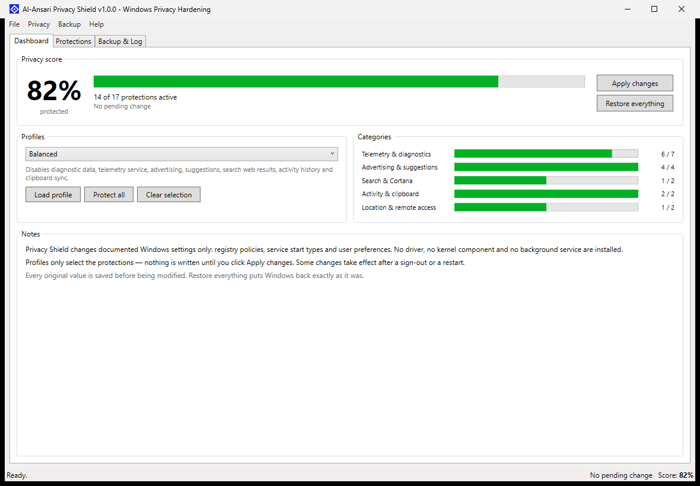
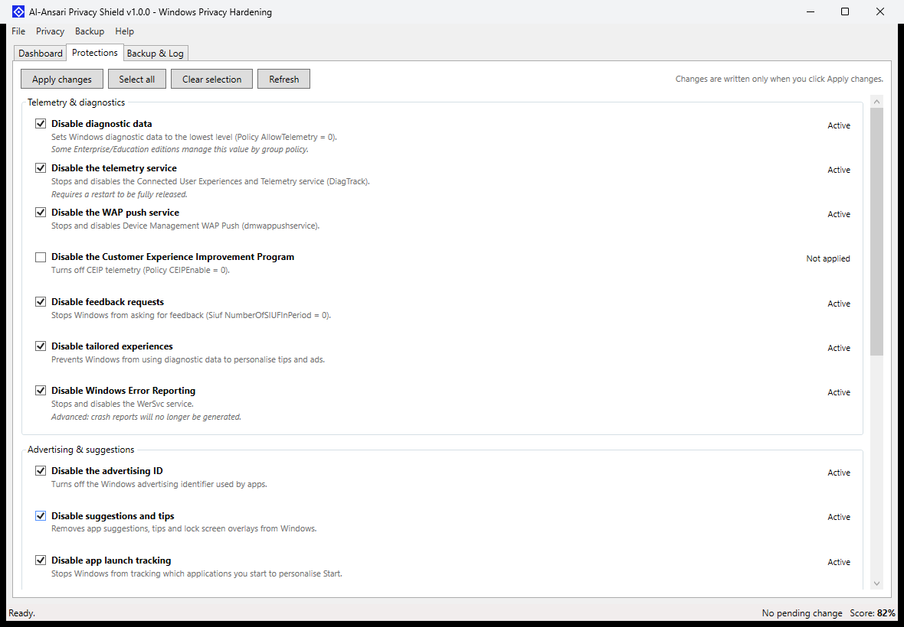
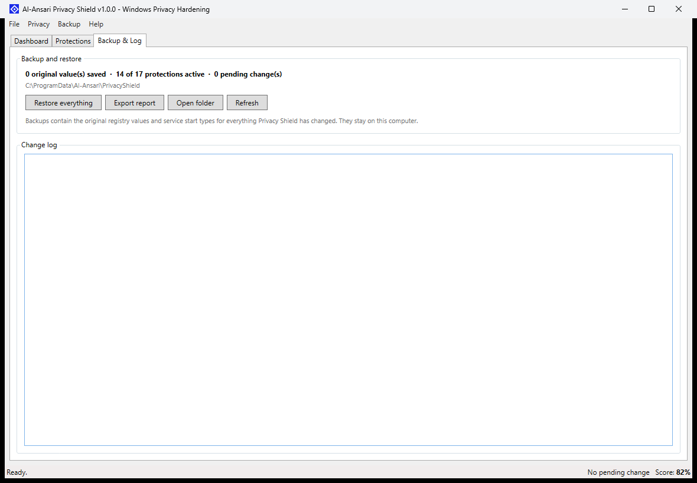

<p align="center">
  
</p>

<h1 align="center">AL-ANSARI SOFTWARES</h1>
<h3 align="center">Al-Ansari Privacy Shield</h3>

<p align="center">
  A classic Windows utility that hardens privacy settings and can undo every single change.
</p>

<p align="center">
  <a href="https://github.com/urbanyl/al-ansari-privacy-shield/releases/latest"></a>
  <a href="https://github.com/urbanyl/al-ansari-privacy-shield/releases"></a>
  
  
  
  
  <a href="https://github.com/urbanyl/al-ansari-privacy-shield/stargazers"></a>
</p>

---

## Table of contents

- [Overview](#overview)
- [Screenshots](#screenshots)
- [Features](#features)
  - [Protections](#protections)
  - [Profiles](#profiles)
  - [Safety and restore](#safety-and-restore)
- [Requirements](#requirements)
- [Installation](#installation)
- [Usage](#usage)
- [Build from source](#build-from-source)
- [How it works](#how-it-works)
- [Data and backups](#data-and-backups)
- [Project structure](#project-structure)
- [Disclaimer](#disclaimer)
- [License](#license)

---

## Overview

**Al-Ansari Privacy Shield** is a native WPF utility (no Electron, no browser engine) that turns off the most common Windows data collection and personalisation features: diagnostic data, the telemetry service, advertising ID, suggestions, search web results, activity history, clipboard sync, location and more.

It behaves like a classic Windows tool: a score dashboard, a grouped list of protections, three profiles and a backup panel. Nothing is written until you click **Apply changes**, every original value is saved first, and **Restore everything** puts Windows back exactly as it was.

The application requests administrator rights, keeps running in the notification area when the window is closed, and never contacts the internet.

## Screenshots

| Dashboard | Protections |
| --- | --- |
|  |  |



## Features

### Protections

17 protections across five categories:

| Category | Protections |
| --- | --- |
| **Telemetry & diagnostics** | Diagnostic data policy, DiagTrack service, WAP push service, CEIP, feedback requests, tailored experiences, Windows Error Reporting |
| **Advertising & suggestions** | Advertising ID, suggestions and tips (7 registry values), app launch tracking, search highlights |
| **Search & Cortana** | Cortana policy, web results in Start search |
| **Activity & clipboard** | Activity history (publish/upload), clipboard history and cross-device sync |
| **Location & remote access** | Location services policy, Remote Assistance |

Each protection:
- reads its **real current state** from Windows;
- shows a clear status: Active, Not applied, or Pending: enable/disable;
- is applied only when you ask for it;
- is saved with its original value before the first change.

### Profiles

| Profile | Scope |
| --- | --- |
| **Balanced** | Diagnostic data, telemetry service, advertising, suggestions, search web results, activity history, clipboard sync |
| **Strict** | Balanced plus WAP push, CEIP, Cortana and location services |
| **Maximum** | All protections, including Windows Error Reporting and Remote Assistance |

Profiles only *select* protections. You review the pending changes, then apply them.

### Safety and restore

- Automatic backup in `%ProgramData%\Al-Ansari\PrivacyShield\backup.json` (registry values and service start types).
- Change journal and report export.
- One-click **Restore everything** (also available for individual settings by clearing their checkbox and applying).
- No driver, no kernel component, no Windows service and no installer.
- Administrator elevation through `requireAdministrator`; tray mode when the window is closed.
- Privacy score, per-category progress and pending-change counter.

## Requirements

- Windows 10 or Windows 11 (x64).
- Administrator rights (requested automatically at launch).
- For the source build: .NET 10 SDK with the Windows Desktop workload.
- The release package is self-contained; no .NET runtime installation is needed.

## Installation

1. Open the [latest release](https://github.com/urbanyl/al-ansari-privacy-shield/releases/latest).
2. Download `Al-Ansari-Privacy-Shield-1.0.0-win-x64.zip`.
3. Extract the archive anywhere.
4. Run `AlAnsariPrivacyShield.exe` and accept the UAC prompt.

## Usage

1. Open the **Dashboard** to see the privacy score and the state of each category.
2. Open **Profiles**, pick Balanced, Strict or Maximum, then click **Load profile**.
3. Review the pending changes in **Protections** and click **Apply changes**.
4. Sign out or restart Windows when a protection requires it.
5. To undo everything, open **Backup & Log** and click **Restore everything**.

## Build from source

```powershell
git clone https://github.com/urbanyl/al-ansari-privacy-shield.git
cd al-ansari-privacy-shield
dotnet build -c Release
dotnet run --project AlAnsariPrivacyShield
```

Publish a self-contained single file:

```powershell
dotnet publish AlAnsariPrivacyShield/AlAnsariPrivacyShield.csproj `
  -c Release -r win-x64 --self-contained true `
  -p:PublishSingleFile=true `
  -p:IncludeNativeLibrariesForSelfExtract=true `
  -o artifacts/win-x64
```

## How it works

| Area | Mechanism |
| --- | --- |
| Diagnostic data | `HKLM\SOFTWARE\Policies\Microsoft\Windows\DataCollection\AllowTelemetry` = 0 |
| Telemetry services | Service `Start` value set to 4 (disabled) and service stopped (`sc stop`) |
| Advertising ID | `HKCU\SOFTWARE\Microsoft\Windows\CurrentVersion\AdvertisingInfo\Enabled` = 0 |
| Suggestions and tips | Seven `ContentDeliveryManager` values set to 0 |
| Cortana | `HKLM\SOFTWARE\Policies\Microsoft\Windows\Windows Search\AllowCortana` = 0 |
| Web results in Start | `HKCU\SOFTWARE\Policies\Microsoft\Windows\Explorer\DisableSearchBoxSuggestions` = 1 |
| Activity history | `PublishUserActivities` and `UploadUserActivities` = 0 |
| Clipboard | `AllowClipboardHistory` and `AllowCrossDeviceClipboard` = 0 |
| Location | `HKLM\SOFTWARE\Policies\Microsoft\Windows\LocationAndSensors\DisableLocation` = 1 |
| Remote Assistance | `HKLM\SYSTEM\CurrentControlSet\Control\Remote Assistance\fAllowToGetHelp` = 0 |

Service control uses the documented `sc.exe` command; policies are standard Windows registry values. No undocumented driver interface is used.

## Data and backups

```
%ProgramData%\Al-Ansari\PrivacyShield\
├── backup.json        original registry values and service start types
├── history.log        change journal
└── report-*.txt       exported reports
```

## Project structure

```
Al-Ansari-Privacy-Shield/
├── AlAnsariPrivacyShield/
│   ├── Infrastructure/     commands and observable objects
│   ├── Models/             settings, categories, profiles
│   ├── Services/           catalog, privacy engine, backup store
│   ├── ViewModels/         main view model
│   ├── Assets/             application icon
│   ├── SplashWindow.*      loading screen
│   └── MainWindow.*        classic Win32-style UI
├── docs/
│   ├── logo.png / logo.svg
│   └── screenshots/
├── LICENSE
└── README.md
```

## Disclaimer

This tool changes documented Windows privacy settings and stops selected services. Some changes may affect Windows features (Cortana, search suggestions, error reporting, clipboard sync or location). Everything is reversible through the built-in backup, but a restart or sign-out may be required. Use it on devices you own or are authorized to manage. The authors are not responsible for misuse.

## License

[MIT](LICENSE) © 2026 Al-Ansari Softwares
